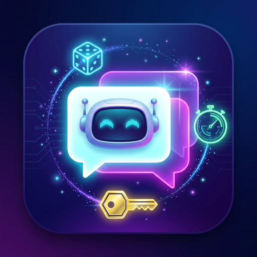

<div align="center">

# Not Spammy, Not Silent — Active Replies, Just Right


**An AstrBot plugin for rate-limited proactive replies: probability draw + group cooldown + conversation continuation + keyword triggers — so your bot mingles in group chats naturally, like a real person.**


[简体中文](README.md) | English



</div>

> 📦 **Note**: This repository is a **plugin component for [AstrBot](https://github.com/AstrBotDevs/AstrBot)** and cannot run standalone. Install it into AstrBot's `data/plugins/` directory and let the AstrBot framework load and dispatch it.

---

## Table of Contents

- [The Problem It Solves](#the-problem-it-solves)
- [Features](#features)
- [Installation](#installation)
- [Configuration](#configuration)
- [How It Works](#how-it-works)
- [Tuning Guide](#tuning-guide)
- [Notes](#notes)
- [Version History](#version-history)

---

## The Problem It Solves

AstrBot's built-in "Group Context Awareness → Proactive Reply" offers only a **pure probability draw**, which creates a dilemma:

- **Higher probability** → the bot keeps butting in in active groups, which is annoying;
- **Lower probability** → the bot practically never speaks, so why enable it at all.

This plugin adds a **group-level cooldown** and a **conversation-occupancy guard** on top of the probability draw, plus two stable trigger paths — "conversation continuation" and "keyword reply" — balancing liveliness and restraint.

---

## Features

| Trigger Path | How It Fires | Rate Control | Best For |
|----------|----------|----------|----------|
| 🎲 Proactive reply | Probability draw hit | Group cooldown (default 180s) + occupancy guard | Occasional natural remarks to stay present |
| 💬 Conversation continuation | Follow-up messages within the window after a member @mentions/quotes/wakes the bot | Member-level cooldown (default 10s), replies by default within the window | Keeping follow-up questions alive |
| 🔑 Keyword reply | Message contains a configured keyword | Member-level cooldown (default 8s), replies by default | Always responding to its nickname |

### Other Built-in Guards

| Guard | Effect |
|------|------|
| Conversation-occupancy guard | While someone is talking with the bot, the probability path stays silent and won't butt into unrelated chatter |
| Talking-to-others filter | No random interjections when a message @mentions or quotes someone else (the continuation path likewise bails out) |
| Anti-loop | Ignores the bot's own messages — no self-triggering even with "report own messages" enabled |
| Whitelist | Optionally restrict the plugin to specific groups only |
| Content-length threshold | Very short plain texts won't trigger the probability path (messages with images are exempt) |
| Hot config reload | Saving config in the WebUI takes effect immediately, no AstrBot restart needed |

---

## Installation

### Option 1: Plugin Marketplace (Recommended)

AstrBot WebUI → Plugin Management → Install from marketplace, search for `astrbot_plugin_active_reply_ctl`.

### Option 2: Download from Releases

Download the latest package (`astrbot_plugin_active_reply_ctl-vX.Y.Z.zip`) from the [Releases](../../releases) page, then import it in the AstrBot WebUI via "Plugin Management → Upload & Install".

### Option 3: Manual Clone

```bash
cd AstrBot/data/plugins
git clone https://github.com/RandyLuaW/astrbot_plugin_active_reply_ctl.git
```

> [!TIP]
> This plugin has no third-party dependencies — no extra requirements needed.

### One Thing You Must Do Before Enabling

> [!WARNING]
> In the AstrBot WebUI, **disable the built-in proactive reply** to avoid double triggering:
>
> Config page → Group Context Awareness → Proactive Reply toggle → **OFF**

---

## Configuration

### Basics

| Option | Description | Default |
|------|------|--------|
| `enable` | Master switch | `true` |
| `whitelist` | Group whitelist (group IDs as strings); empty = all groups | `[]` |
| `min_message_len` | Minimum text length for the probability path; messages with images are exempt | `2` |

### Proactive Reply

| Option | Description | Default |
|------|------|--------|
| `possibility` | Draw hit rate; can be raised since the group cooldown acts as a cap | `0.02` |
| `cooldown_seconds` | Minimum interval between two proactive replies in the same group (seconds); `0` disables | `180` |
| `prompt_template` | Prompt sent to the LLM on trigger; placeholder `{message}` | See below |

### Conversation Continuation

| Option | Description | Default |
|------|------|--------|
| `continue_window_seconds` | Continuation window after an interaction (seconds); `0` disables continuation | `120` |
| `continue_possibility` | Trigger probability within the window; `1.0` = always reply | `1.0` |
| `continue_cooldown_seconds` | Minimum interval between two continuation replies for the same member (seconds) | `10` |
| `continue_prompt_template` | Continuation prompt; placeholders `{message}`, `{member}` | See below |

### Keyword Reply

| Option | Description | Default |
|------|------|--------|
| `keyword_list` | Keywords that trigger a reply on hit (e.g. the bot's nickname); empty = disabled | `[]` |
| `keyword_possibility` | Trigger probability after a keyword hit | `1.0` |
| `keyword_cooldown_seconds` | Minimum interval between two keyword replies for the same member (seconds) | `8` |

### Misc

| Option | Description | Default |
|------|------|--------|
| `ignore_when_chatting` | Occupancy guard: probability path stays silent while someone is within the continuation window | `true` |

### Default Prompts

Probability path: tells the LLM "there is a message in the group chat that did not @ you", and asks it to reply naturally and briefly in its current persona — no customer-service tone, no essays.

Continuation path: tells the LLM "you are in an ongoing conversation with a member" and asks it to continue the conversation. `{message}` is replaced with the triggering message text, and `{member}` with the member's nickname.

---

## How It Works

```
Group message arrives
   │
   ├─ @Bot / wake word / quote of Bot ──► handed back to AstrBot's main reply pipeline
   │                                       (opens the member's continuation window)
   │
   ├─ Message directed at someone else (@ or quote) ──► ignored
   │
   ├─ Keyword hit ──► member cooldown check ──► probability draw ──► reply
   │
   ├─ Within continuation window ──► member cooldown check ──► probability draw ──► reply
   │
   └─ Probability path ──► occupancy guard ──► group cooldown ──► probability draw
                     ──► length/image check ──► reply
```

On trigger, the plugin calls `event.request_llm(...)` with the current persona and context; replies go through AstrBot's standard LLM pipeline and are recorded in the conversation history as usual.

### Rate-Control Details

- **Cooldowns only start on an actual trigger**: intercepted messages never extend cooldowns, so the bot won't go silent just because it declined a few times
- **Three cooldown layers are independent**: the group cooldown only constrains the probability path; continuation and keyword paths are subject only to their own member-level cooldowns
- **Automatic memory cleanup**: expired cooldown records are purged every 100 hits, no memory leaks
- **Hard checks first, draw last**: occupancy guard, whitelist, and length threshold filter messages before the draw, so no draw is wasted

---

## Tuning Guide

| Goal | Suggestion |
|------|------|
| Keep large groups calm | Keep `possibility` at `0.02` and `cooldown_seconds` at `180` |
| More active in small groups | Raise `possibility` to `0.05~0.1`, lower group cooldown to `60~120` |
| Follow-ups keep getting missed | Make sure `continue_possibility = 1.0` and extend the window to `180` |
| Reply only when called by name | Set `possibility` to `0` to mute the probability path, keep keyword replies |
| Keeps butting into others' talks | Make sure `ignore_when_chatting = true` |

---

## Notes

> [!IMPORTANT]
> This repository is an AstrBot plugin component only; it must run together with AstrBot and cannot run standalone.

- The built-in "Group Context Awareness → Proactive Reply" must be turned off, otherwise messages will be triggered twice
- Messages that @Bot / use the wake prefix / quote the Bot are handled by AstrBot's main pipeline; this plugin only handles proactive replies to messages that did not @ the bot
- Supports visual configuration in the AstrBot WebUI (via `_conf_schema.json`) with hot reload on save

---

## Version History

### v1.4.1
- Add a logo: new plugin icon `logo.png` so the AstrBot WebUI marketplace and plugin list show a custom icon

### v1.4.0
- Fixed missed continuation replies: continuation probability `0.5` → `1.0` (the draw used to randomly drop half of the follow-ups)
- Added "talking-to-others filter": no longer butts in when a message @mentions or quotes someone else
- Added "conversation-occupancy guard" `ignore_when_chatting`: the probability path stays silent while the bot is talking with someone

### v1.3.0
- WebUI visual configuration with hot reload (`_conf_schema.json`)
- Fallback to the plugin-directory `config.json` when no config is injected

### v1.2.1
- Continuation safety: messages @mentioning or quoting someone else (not the bot) no longer count as continuation

### v1.2.0
- Added keyword replies: hitting a keyword triggers a stable reply, bypassing the group cooldown and the probability draw

### v1.1.0
- Added conversation continuation window: follow-up messages within the window after an interaction trigger stably, keeping follow-ups alive

### v1.0.0
- First stable release: group cooldown, whitelist, minimum message length, anti-loop, and prompt templates

See [CHANGELOG.md](CHANGELOG.md) for the full changelog.

---

## Acknowledgements

- Plugin icon generated by AI (Gemini)
- Homepage layout inspired by [astrbot_plugin_get_px](https://github.com/shitianyaa/astrbot_plugin_get_px)
- Visitor counter powered by [Moe Counter](https://github.com/journey-ad/Moe-Counter)

---

**🌟 If this plugin helps you, please give it a Star!**

## License

[MIT](LICENSE) © Randy Lua
